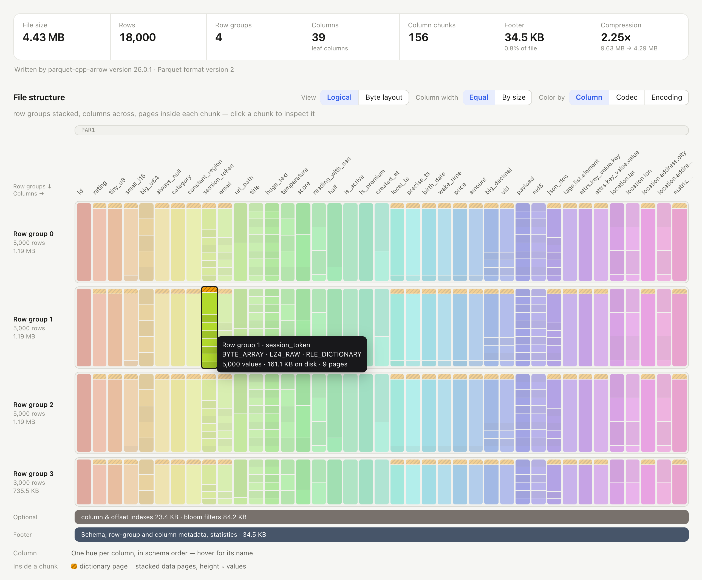
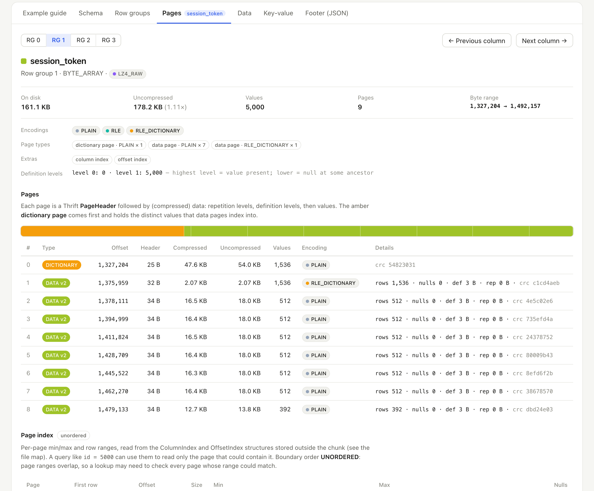
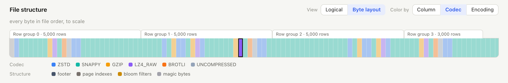
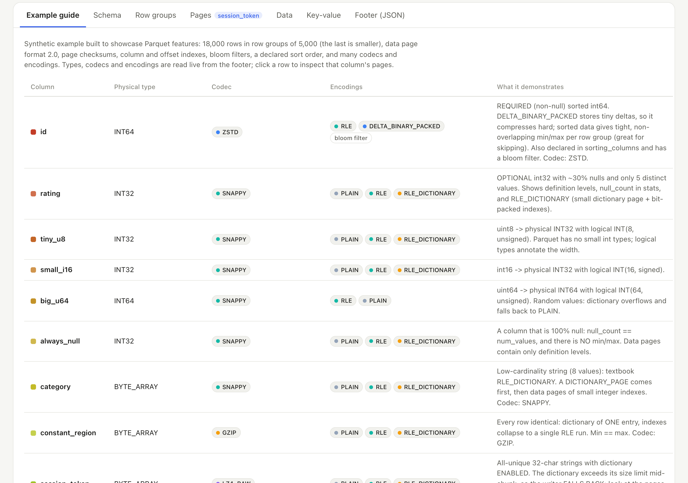
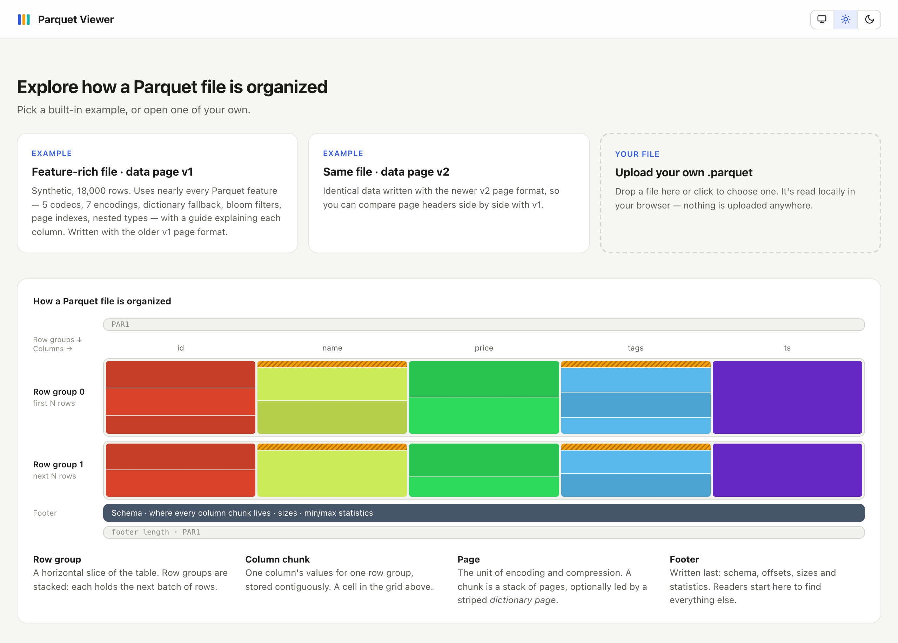

# Parquet Viewer

A small local web app for seeing how a Parquet file is organized on the inside. Open a file and explore its row groups, column chunks, pages, encodings, compression, statistics, schema and data. Pick one of the built-in examples or open your own `.parquet` file.

Everything runs in your browser. Files you open are read locally and never uploaded anywhere. Light and dark themes are built in: use the switch in the top right, or leave it on auto to match your system.

<picture>
  <source media="(prefers-color-scheme: dark)" srcset="docs/screenshots/structure-dark.png">
  
</picture>

## What it looks like

### See how the file is laid out

Row groups are stacked top to bottom, columns run across, and each cell is a column chunk made of pages. The striped amber strip is a dictionary page. Click any chunk to inspect it, hover for details, and color the grid by column, codec or encoding.

### Look inside a column chunk

Every page in a chunk, with its type, size, encoding, value count and checksum, plus the page index (per-page min/max). This one shows dictionary encoding falling back to plain pages partway through a chunk.

<picture>
  <source media="(prefers-color-scheme: dark)" srcset="docs/screenshots/pages-dark.png">
  
</picture>

### Or see the raw byte layout

Switch to the byte view to see every byte of the file in order, to scale.

<picture>
  <source media="(prefers-color-scheme: dark)" srcset="docs/screenshots/byte-layout-dark.png">
  
</picture>

### Learn from the built-in examples

Two synthetic example files use nearly every Parquet feature: five codecs, seven encodings, dictionary fallback, bloom filters, page indexes, nested types and more. An **Example guide** tab explains what each column demonstrates.

<picture>
  <source media="(prefers-color-scheme: dark)" srcset="docs/screenshots/example-guide-dark.png">
  
</picture>

### Open your own files

Start from an example, or drop in any `.parquet` file.

<picture>
  <source media="(prefers-color-scheme: dark)" srcset="docs/screenshots/landing-dark.png">
  
</picture>

## Run it

You need [Node.js](https://nodejs.org) installed.

```
npm install
npm start
```

Then open http://localhost:8765.
